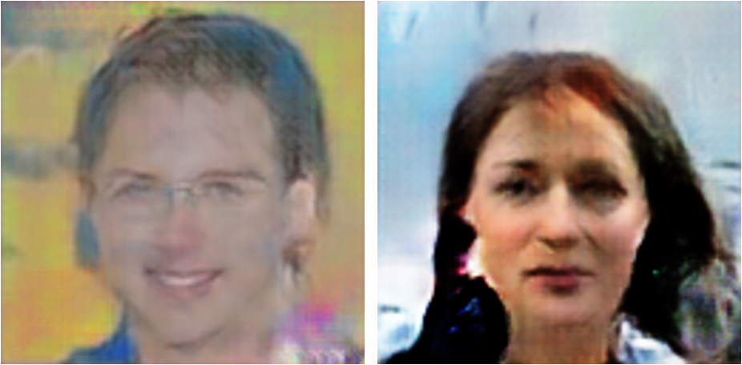

# Conditional Face Generation with AC-WGAN-GP


This project implements an **Auxiliary Classifier Wasserstein GAN with Gradient Penalty (AC-WGAN-GP)** to generate high-quality human faces with controllable attributes. Trained on the **CelebA dataset**, the model allows for the precise manipulation of specific features such as *Gender*, *Hair Color*, *Smile*, and more.

## 📌 Project Overview

Generative Adversarial Networks (GANs) are powerful tools for synthesizing realistic data. This project leverages the **AC-GAN** architecture to condition generation on class labels, combined with **WGAN-GP** (Wasserstein GAN with Gradient Penalty) for stable training and high convergence reliability.

### Key Features
- **Conditional Generation**: Generate faces based on specific attributes (e.g., "Smiling Young Woman with Blond Hair").
- **Stable Training**: Uses Wasserstein loss with Gradient Penalty to prevent mode collapse and keep gradients smooth.
- **Disentanglement**: Demonstrates the ability to separate style (random noise) from content (attributes).
- **FID Evaluation**: Integrated Frechet Inception Distance (FID) monitoring to track generation quality.

## 🛠️ Architecture

The model consists of two main networks:
1.  **Generator**: Takes a latent noise vector $z$ and a target attribute vector $c$, upsampling them via transposed convolutions to a $128 \times 128$ RGB image.
2.  **Discriminator**: A Convolutional Neural Network that outputs:
    - **Validity Score**: Real vs. Fake (Critic).
    - **Class Probabilities**: Attribute classification (Auxiliary Classifier).

The loss function combines the Wasserstein distance, Gradient Penalty, and Binary Cross Entropy for attribute classification.

## 🚀 Installation

### 1. Clone the repository
```bash
git clone https://github.com/louisrodembourg/conditional-face-gan.git
cd conditional-face-gan
```

### 2. Environment Setup
It is recommended to use a virtual environment.
```bash
python -m venv .venv
source .venv/bin/activate  # On Windows use: .venv\Scripts\activate
pip install -e .
```

### 3. Dataset Preparation
Download the **CelebA** dataset and place `img_align_celeba` and `list_attr_celeba.csv` in the `data/` directory.
```
conditional-face-gan/
├── data/
│   ├── img_align_celeba/
│   │   └── img_align_celeba/
│   │       ├── 000001.jpg
│   │       └── ...
│   └── list_attr_celeba.csv
```

## 💻 Usage

### Training
To train the model from scratch:
```bash
python src/main.py --mode train
```
*Checkpoints and logs (TensorBoard) are saved in `checkpoints/<run_name>/` and `logs/<run_name>/`. The generator with the lowest FID is saved as `checkpoints/<run_name>/best_fid_model.pth`.*

### Inference / Generation
Generate images using a trained model.

**Single Generation:**
```bash
# Example: Generate a Smiling(1) Young(1) Woman(0) with Blond Hair(1) and Eyeglasses(0)
# Attribute Order: [Male, Blond_Hair, Smiling, Eyeglasses, Young]
python src/main.py --mode generate --weights checkpoints/<run_name>/best_fid_model.pth --attr 0 1 1 0 1
```

**Grid Generation:**
Generates a grid of all attribute combinations for visualization.
```bash
python src/main.py --mode generate_grid --weights checkpoints/<run_name>/best_fid_model.pth
```

## 📊 Results & Visualization

Training progress can be monitored via TensorBoard:
```bash
tensorboard --logdir logs/
```

### Samples
Here are the results from the **final generation version** of the model.



**Controlled Attributes:**
The model was trained to disentangle and control the following features:
*   ✅ **Male** (vs Female)
*   ✅ **Blond Hair** (vs Brown/Black)
*   ✅ **Smiling** (vs Neutral)
*   ⚠️ **Eyeglasses** (Challenging but functional)
*   ✅ **Young** (vs Old - *Note: The 'Old' attribute is currently harder to generate due to dataset imbalance*)

This grid demonstrates the model's capability to maintain identity while swapping specific attributes.

## 📂 Project Structure
```
├── src/                 # Source code
│   ├── config.py        # Hyperparameters & Paths
│   ├── models.py        # Generator & Discriminator Architecture
│   ├── train.py         # Training Loop
│   ├── data.py          # Data Loading & Preprocessing
│   ├── utils.py         # Gradient penalty, metrics, label sampling, visualization
│   ├── generate.py      # Inference & annotated grid generation
│   └── main.py          # Entry point
├── notebooks/           # Jupyter Notebooks for analysis
├── pyproject.toml       # Project Dependencies
└── README.md            # Project Documentation
```

## 📝 License
This project is licensed under the MIT License — see [LICENSE](LICENSE).
